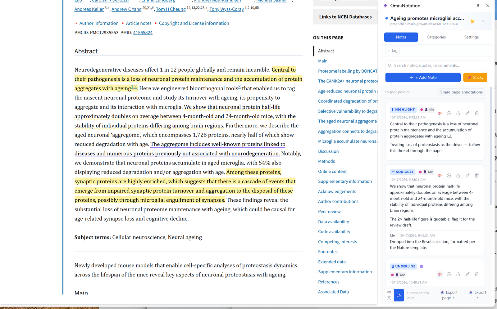
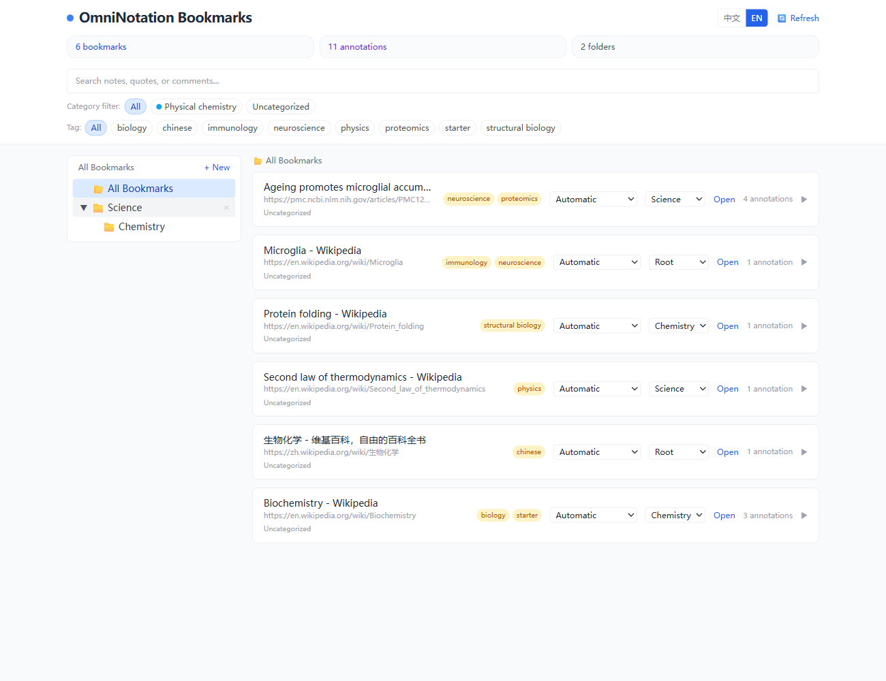
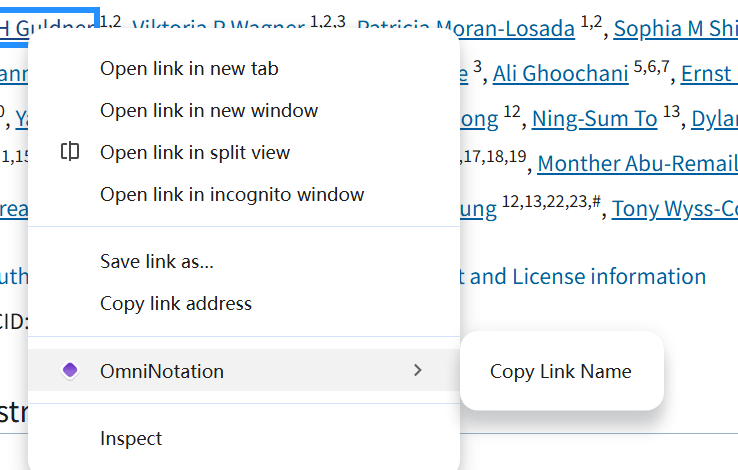

# OmniNotation

<p align="center">
  
</p>

<p align="center">
  <b>Universal Web Page Annotation & Bookmark Manager</b>
</p>

<p align="center">
  <a href="./README.md"></a>
  <a href="./README.zh-CN.md"></a>
</p>

<p align="center">
  <a href="#features">Features</a> •
  <a href="#screenshots">Screenshots</a> •
  <a href="#installation">Installation</a> •
  <a href="#usage">Usage</a> •
  <a href="#development">Development</a> •
  <a href="#changelog">Changelog</a> •
  <a href="https://knoweave.com/tools/omninotation/">Website</a>
</p>

---

## Overview

OmniNotation is a Chrome browser extension that turns any web page into an annotatable canvas with a powerful bookmark manager. Using Chrome's native Side Panel, it provides a seamless annotation experience without injecting intrusive UI elements into the page.

Key highlights:

- 📝 **Native Side Panel** — Uses Chrome's official `sidePanel` API for a first-class experience
- 🎯 **Persistent Text Highlights** — Anchors selections using `dom-anchor-text-quote` for robust text quote resolution across page reloads
- 🔄 **Bidirectional Navigation** — Click a highlight to open the side panel & jump to its annotation; click an annotation card to scroll to its highlight
- 🎨 **4 Highlight Styles + Per-Annotation Color** — Highlight, underline, strikethrough, squiggly underline; each annotation can have its own color
- 🌙 **Dark Mode Aware** — Highlight colors automatically deepen when the system prefers dark mode
- 🔗 **Right-click Menu on Links** — Copy a link's display text with one click, straight from the browser's native context menu
- 📁 **Nested Bookmark Folders** — Multi-level folder organization for your annotated pages
- 🔖 **Auto-Bookmark** — Pages with annotations are automatically bookmarked
- 🏷️ **Page-Level Tags & Visibility** — Tag and control access per page, not per annotation
- 💬 **Hierarchical Replies** — Nested comment threads with full Markdown + KaTeX support
- 🧭 **SPA-Aware** — Automatically re-renders highlights on dynamic SPA navigation
- 🔍 **Smart Floating Toolbar** — Select text to pop up a toolbar with annotate, copy, and multi-engine search

## Screenshots

<table>
  <tr>
    <td width="62%" align="center"></td>
    <td width="38%" align="center"></td>
  </tr>
  <tr>
    <td align="center"><sub>Highlights on the page + annotations in the Side Panel</sub></td>
    <td align="center"><sub>Bookmark dashboard with folders, tags and categories</sub></td>
  </tr>
  <tr>
    <td colspan="2" align="center">
      
      <br><sub>Right-click a link → <b>OmniNotation ▸ Copy Link Name</b> copies the link's display text</sub>
    </td>
  </tr>
</table>

## Features

| Feature | Description |
|---------|-------------|
| **Text Highlighting** | Select any text and annotate with 4 mark styles. Highlights persist across reloads using text-quote anchoring. |
| **Context Menu** | Right-click selected text to instantly highlight with your preferred style (highlight / underline / strikethrough / squiggly). |
| **Copy Link Name** | Right-click any link and pick **OmniNotation ▸ Copy Link Name** from the browser's own context menu — copies the link's *display text* (not the URL) to the clipboard in one click. |
| **Sticky Notes** | Place sticky notes anywhere on the page with a single click. |
| **Side Panel UI** | Chrome native side panel showing all annotations for the current page with Markdown & KaTeX rendering. |
| **Per-Annotation Color** | Override the global highlight color for any individual annotation. |
| **Dark Mode Adaptation** | Detects `prefers-color-scheme: dark` and automatically deepens highlight opacity for comfortable reading. |
| **Click Highlight → Open Panel** | Click any mark on the page to automatically open the side panel and scroll to the corresponding annotation. |
| **Drag & Drop Sorting** | Annotations sorted by page Y-position by default. Drag to reorder manually. Reset anytime. |
| **Nested Replies** | Reply to any comment, and reply to replies — fully hierarchical thread support. |
| **Color Picker** | 6 highlight colors (yellow/blue/green/red/purple/orange). Broadcasts to all tabs instantly. |
| **Page Tags** | Add tags to bookmarked pages for quick categorization and filtering. |
| **Bookmark Folders** | Organize bookmarked pages into nested folders via the Options dashboard. |
| **Global Search** | Search across all annotations, quotes, replies, and tags from the bookmark dashboard. |
| **SPA Support** | MutationObserver with smart re-rendering — only re-renders when highlight count mismatch is detected. |
| **Selection Toolbar** | Select text on any page to pop up a floating toolbar with annotate, **copy**, and multi-engine search options. |
| **Multi-Engine Search** | Search selected text via Google, Google Scholar, PubMed, Wikipedia, [KnoWeave](https://knoweave.com) and custom engines. Supports new-tab control and offline icon caching. |
| **Copy Selection** | One-click copy selected text from the floating toolbar. |
| **Engine Icon Management** | Search engine icons are downloaded to `assets/icons/` for offline use. Custom engines auto-download icons; manual download button available in settings. Emoji or Chinese characters can also be used as icons. |
| **Export / Import (Markdown)** | Backup and restore all your data as Markdown files. |

## Installation

### From Chrome Web Store

> _Coming soon — the extension is currently in development._

### Developer Mode (Local Install)

1. Clone this repository:
   ```bash
   git clone https://github.com/natureanalysis/omninotation.git
   cd omninotation
   ```

2. Install dependencies:
   ```bash
   npm install
   # or
   pnpm install
   ```

3. Download search engine icons:
   ```bash
   node scripts/download-engine-icons.mjs
   ```

4. Build the extension:
   ```bash
   npm run build
   # or
   pnpm build
   ```

5. Open Chrome and navigate to `chrome://extensions/`

6. Enable **Developer mode** (toggle in the top right)

7. Click **Load unpacked** and select the `build/chrome-mv3-prod` folder

8. The extension icon should appear in your toolbar. Click it to open the Side Panel.

> **First run?** A fresh install has no page access yet. Open the Side Panel → **Settings** → **Page annotation access** → **Enable page annotations** once; right-click menus and highlights then work on every site.

## Usage

### Adding an Annotation

1. **Via context menu**: Select text → right-click → choose a mark style (▌ Highlight / U̲ Underline / S̶ Strikethrough / 〰 Squiggly). The side panel will open automatically.
2. **Via sticky note**: Click the "📌 Sticky" button in the side panel → click anywhere on the page to place a note.
3. **Via side panel**: Click "+ Add Note" to add a page-level note without text selection.

### Managing Annotations

- **Scroll to highlight**: Click any annotation card in the side panel to smoothly scroll to the corresponding text on the page.
- **Click highlight**: Click any highlighted text (`<mark>`) on the page to automatically open the side panel and scroll its card into view.
- **Reply**: Click 💬 under any annotation to add a reply. Reply to replies for nested threads.
- **Edit**: Click "Edit" on any annotation or reply to modify its content.
- **Status**: Toggle "✓ Resolved" to mark an annotation as done.
- **Color**: Click 🎨 on any annotation card to set a custom color for that specific annotation.
- **Reorder**: Drag and drop cards to customize order. Click "Reset to Page Order" to restore default sorting.

### Right-click Menu

OmniNotation adds its items to the browser's **own** context menu, so everything the page offers (open in new tab, save as, inspect…) keeps working.

- **Copy Link Name** — Right-click any link and choose **OmniNotation ▸ Copy Link Name** to copy the link's *display text* to the clipboard. Handy for citing author names, paper titles or dataset names while writing Markdown.
- **Mark styles** — Right-click selected text to save it with a mark style (▌ / U̲ / S̶ / 〰).
- **Links inside an annotation** — Right-click a link that is part of an annotated highlight and two more items appear: **Copy text** and **Delete annotation**.
- **Highlights and sticky notes** — Right-click a mark or sticky note that is not a link to open the in-page menu with **Copy text** / **Delete annotation**.

### Selection Toolbar

When you select text on any page, a floating toolbar appears near the selection:

- **Annotate**: Choose a mark style to save the selection as an annotation.
- **Copy**: One-click copy the selected text to clipboard.
- **Search**: Click any search engine icon to search the selected text. Icons are loaded from local storage for instant display.
- **Hover to keep open**: The toolbar auto-closes after a delay, but hovering over it or the selected text keeps it open.

### Search Engine Settings

Open the side panel → **Toolbar Settings** to manage search engines:

- **Add custom engine**: Provide a name and URL template with `%s` as the query placeholder.
- **Edit engine**: Click ✎ to modify an existing engine's name, URL, or icon.
- **Download icon**: Click ⬇ to download the engine's favicon to local storage. If it fails, set a custom icon URL or use an emoji/character.
- **Reorder**: Use ↑ ↓ to change the engine order.
- **Toggle**: Check/uncheck to enable or disable an engine.

### Tags & Categories

- **Page Tags**: Click "+ Tag" in the side panel header to add tags to the current page.
- **Page Categories**: Pick a category in the side panel's Categories tab; the toolbar icon follows the category color.
- **Sharing**: Sign in to [KnoWeave](https://knoweave.com) in the Settings tab, then share selected annotations (accounts are created on the website).

### Bookmark Dashboard

Click the 📊 button in the side panel header (or go to `chrome://extensions` → OmniNotation → Extension options) to open the Bookmark Manager:

- **Nested Folders**: Create multi-level folders to organize your bookmarked pages.
- **Move to Folder**: Use the dropdown on each bookmark to move it between folders.
- **Global Search**: Search across all annotations, quotes, replies, and tags.
- **Tag Filter**: Click tag badges to filter bookmarks by tag.
- **Jump**: Click "Open" on any annotation to open the page and auto-scroll to the highlight.

### Backup

In the side panel footer:

- **Export Page**: Download a Markdown backup of the current page's annotations.
- **Import to Page**: Restore a page's annotations from a Markdown file.
- **Export All**: Download a Markdown backup of all your data.
- **Import All**: Restore everything from a Markdown backup file.

## Development

```bash
# Download default search engine icons
node scripts/download-engine-icons.mjs

# Start development server with hot reload
npm run dev
# or
pnpm dev

# Build for production
npm run build
# or
pnpm build

# Package as a zip for distribution
npm run package
# or
pnpm package
```

> **Dev Caveat**: The extension auto-reloads on save when using `plasmo dev`. Open pages must be refreshed for the content script to be reinjected. If you see "Extension context invalidated", refresh the page.

## Project Structure

```
omninotation/
├── src/
│   ├── background/
│   │   └── index.ts              # Service worker: context menu, icon tinting, side panel open
│   ├── contents/
│   │   └── omninotation.tsx      # Content script: highlight injection, SPA observer, sticky notes
│   ├── components/
│   │   ├── AnnotationCard.tsx    # Single annotation card (side panel)
│   │   ├── AnnotationContextMenu.tsx # In-page menu on right-clicking a mark / sticky note
│   │   ├── MarkdownContent.tsx   # Markdown + KaTeX renderer (sanitized before insert)
│   │   ├── MarkdownEditor.tsx    # Markdown editor with optional live preview
│   │   ├── CategoryPanel.tsx     # Page categories: pick, manage, auto rules
│   │   ├── CategoryIconSwatch.tsx# Canvas preview sharing the toolbar icon renderer
│   │   ├── HubAccount.tsx        # KnoWeave sign-in / shares / sync
│   │   ├── HubShareDialog.tsx    # Select annotations and upload a share
│   │   ├── SelectionToolbar.tsx  # Floating toolbar on text selection (annotate / copy / search)
│   │   └── ToolbarSettings.tsx   # Floating toolbar settings (engines, style, triggers)
│   ├── services/
│   │   ├── storage.ts            # Chrome storage abstraction
│   │   ├── i18n.ts               # zh-CN / en strings for every surface
│   │   ├── anchor.ts             # dom-anchor-text-quote wrapper
│   │   ├── highlights.ts         # DOM highlight rendering & lifecycle
│   │   ├── color.ts              # Color presets, dark mode, engine icon mapping
│   │   ├── config.ts             # Domain-specific config
│   │   └── engines.json          # Default search engine definitions
│   ├── types/
│   │   └── index.ts              # TypeScript interfaces
│   ├── sidepanel.tsx             # Chrome native side panel UI
│   ├── options.tsx               # Bookmark manager / dashboard
│   └── style.css                 # Tailwind + custom styles
├── assets/
│   ├── icon.png                  # Extension icon
│   └── icons/                    # Downloaded search engine favicons
├── docs/                         # README screenshots
├── scripts/
│   └── download-engine-icons.mjs # Download default engine favicons to assets/icons/
├── build/                        # Build output
└── package.json
```

## Tech Stack

- [Plasmo](https://www.plasmo.com/) — Browser extension framework
- [React 18](https://react.dev/) — UI library
- [TypeScript](https://www.typescriptlang.org/) — Type safety
- [Tailwind CSS](https://tailwindcss.com/) — Utility-first CSS
- [marked](https://marked.js.org/) — Markdown rendering
- [KaTeX](https://katex.org/) — Math formula rendering
- [dom-anchor-text-quote](https://github.com/tilgovi/dom-anchor-text-quote) — Robust text anchoring

## License

MIT License © OmniNotation Team

## Changelog

Release notes live in [CHANGELOG.md](./CHANGELOG.md).