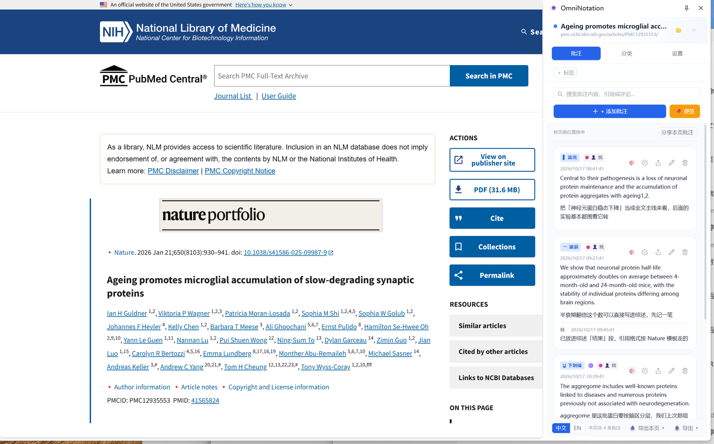
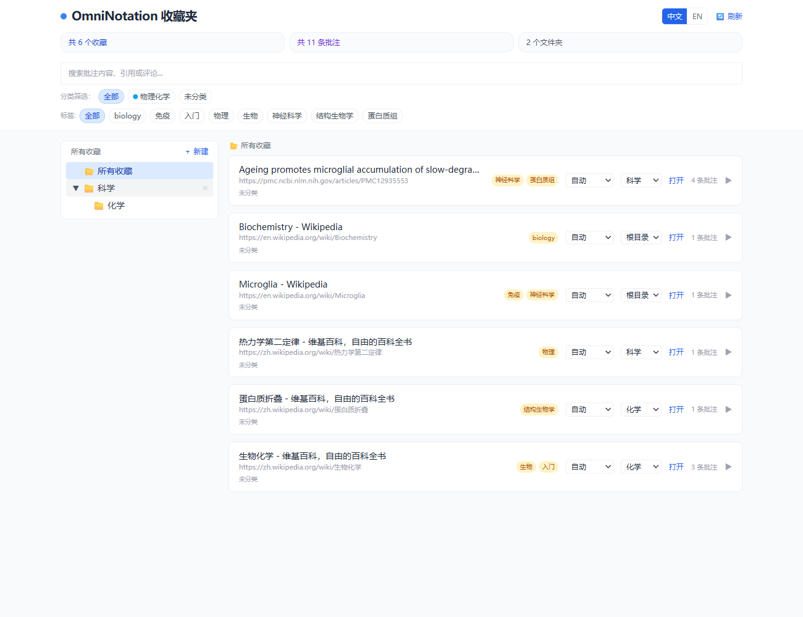
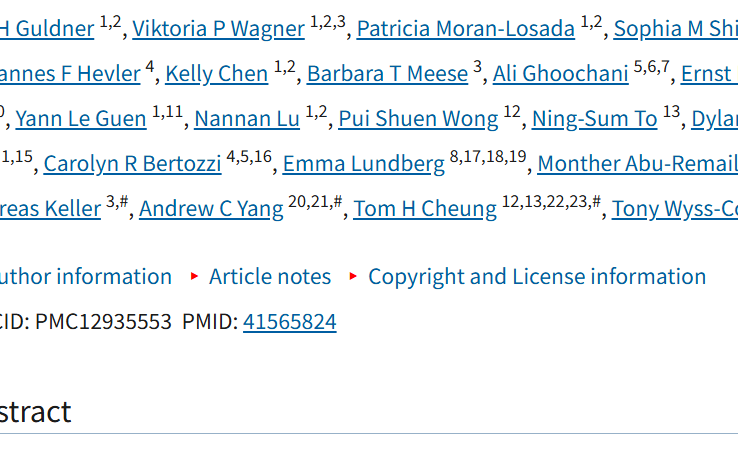

# OmniNotation

<p align="center">
  
</p>

<p align="center">
  <b>通用网页批注与收藏夹管理器</b>
</p>

<p align="center">
  <a href="./README.md"></a>
  <a href="./README.zh-CN.md"></a>
</p>

<p align="center">
  <a href="#核心功能">核心功能</a> •
  <a href="#截图">截图</a> •
  <a href="#快速开始">快速开始</a> •
  <a href="#使用说明">使用说明</a> •
  <a href="#开发">开发</a> •
  <a href="#更新日志">更新日志</a> •
  <a href="https://knoweave.com/tools/omninotation/">官网</a>
</p>

---

## 简介

OmniNotation 是一款 Chrome 浏览器扩展，将任意网页变成可批注的画布，并内置多级文件夹收藏夹管理器。它使用 Chrome 原生Side Panel，不往页面里塞任何多余 UI。

主要亮点：

- 📝 **原生侧边栏** — 使用 Chrome 官方 `sidePanel` API，布局紧凑高效
- 🎯 **高亮可持久** — 用 `dom-anchor-text-quote` 做文本锚索，刷新后高亮原样恢复
- 🔄 **双向导航** — 点击高亮打开侧边栏并定位；点击批注卡片页面滚动到高亮处
- 🎨 **4 种标记样式 + 单条改色** — 高亮、下划线、删除线、波浪线，每条批注可单独设色
- 🌙 **暗色模式适配** — 检测系统暗色模式，高亮颜色自动加深
- 🔗 **链接右键菜单** — 在浏览器原生右键菜单里一键复制链接名称
- 📁 **多级收藏夹** — 收藏页面可放入无限嵌套的文件夹
- 🔖 **自动收藏** — 有批注的页面自动进入收藏
- 🏷️ **页面级标签与可见性** — 按页面打标签、控权限，而不是按批注
- 💬 **层级回复** — 评论可无限嵌套，正文支持 Markdown 与 KaTeX
- 🧭 **SPA 适配** — 单页应用切换路由后自动重绘高亮
- 🔍 **智能浮动工具栏** — 选中文字即弹出工具栏，支持标注、复制、多引擎搜索

## 截图

<table>
  <tr>
    <td width="62%" align="center"></td>
    <td width="38%" align="center"></td>
  </tr>
  <tr>
    <td align="center"><sub>页面高亮 + 侧边栏批注卡片</sub></td>
    <td align="center"><sub>收藏夹面板：文件夹、标签、页面分类</sub></td>
  </tr>
  <tr>
    <td colspan="2" align="center">
      
      <br><sub>右键链接 → <b>OmniNotation ▸ 复制链接名称</b>，一键复制链接文字</sub>
    </td>
  </tr>
</table>

## 核心功能

| 功能 | 说明 |
|------|------|
| **文本高亮** | 选中任意文本即可添加批注，支持 4 种标记样式。使用文本锚索技术持久化，刷新后仍可恢复 |
| **右键菜单（选中文字）** | 右键选中文字，直接选择高亮/下划线/删除线/波浪线样式保存 |
| **复制链接名称** | 右键任意链接，在浏览器**原生**右键菜单里选择 **OmniNotation ▸ 复制链接名称**，把链接的**显示文字**（不是 URL）复制到剪贴板 |
| **便签** | 点击侧边栏「📌 便签」→ 在页面任意位置单击即可放置便签 |
| **原生侧边栏** | 使用 Chrome 官方 `sidePanel` API，批注、分类、设置三个页签 |
| **点击高亮打开侧边栏** | 点击页面上的高亮标记，自动打开侧边栏并定位到对应批注 |
| **双向导航** | 点击批注卡片 → 页面滚动到高亮处；点击高亮 → 侧边栏打开并定位 |
| **层级回复** | 支持评论嵌套，可回复任意层级的评论 |
| **拖拽排序** | 默认按文本在页面中的出现位置排序，也支持手动拖拽自定义顺序 |
| **单个批注颜色** | 每个批注可独立设置颜色，覆盖全局高亮色 |
| **6 种高亮颜色** | 黄/蓝/绿/红/紫/橙，实时同步到所有标签页 |
| **暗色模式适配** | 检测系统暗色模式，高亮颜色自动加深，保护视力 |
| **页面标签** | 为收藏页面添加标签，便于分类检索 |
| **多级收藏夹** | 在选项页中用文件夹组织收藏页面，支持无限嵌套 |
| **全局搜索** | 在收藏夹中跨页面搜索批注内容、引用、回复和标签 |
| **浮动工具栏** | 选中文字弹出工具栏，支持标注、复制、多引擎搜索 |
| **搜索引擎管理** | 内置 Google、Google Scholar、PubMed、维基百科、[KnoWeave](https://knoweave.com) 等引擎，支持自定义，图标自动下载到本地，也可用 Emoji/汉字替代 |
| **页面分类** | 给页面分类后，工具栏图标跟随分类颜色 |
| **导出/导入 (Markdown)** | Markdown 格式备份与恢复，便于阅读和版本控制 |
| **SPA 适配** | 智能检测单页应用导航，仅在必要时重新渲染高亮 |

## 快速开始

### 从应用商店安装

> _即将上线—— 项目仍在开发中。_

### 本地加载（开发者模式）

```bash
git clone https://github.com/natureanalysis/omninotation.git
cd omninotation
npm install
node scripts/download-engine-icons.mjs   # 下载搜索引擎图标
npm run build
```

然后打开 `chrome://extensions/`，开启**开发者模式**，点击**加载已解压的扩展程序**，选择 `build/chrome-mv3-prod` 目录。

> **首次使用？** 新安装默认还没有网页访问权限。在侧边栏「设置」→「页面批注权限」点一次「启用页面批注」，之后右键菜单与高亮在所有网站都可用。

## 使用说明

### 添加批注

- 选中网页文字 → 右键选择标记样式 → 自动保存并打开侧边栏
- 或点击侧边栏「📌 便签」→ 在页面任意位置单击放置
- 或在侧边栏点击「+ 添加批注」添加页面级笔记

### 管理批注

- 点击侧边栏中的批注卡片 → 页面自动滚动到对应高亮文字
- 点击页面上的高亮/下划线等标记 → 自动打开侧边栏并定位到该批注
- 点击 💬 可添加评论，支持回复嵌套评论
- 点击 🎨 可为单个批注设置独立颜色
- 点击 ✓ 可标记为已解决
- 拖拽卡片可自定义排序，点击「重置为页面顺序」恢复默认

### 右键菜单

OmniNotation 把菜单项挂进浏览器**自己的**右键菜单，页面自带的功能（新标签页打开、链接另存为、审查元素）全部照常可用。

- **复制链接名称** —— 右键任意链接 → **OmniNotation ▸ 复制链接名称**，把链接的**显示文字**复制到剪贴板。写 Markdown 引用作者名、论文标题、数据集名字时特别顺手。
- **标记样式** —— 右键选中的文字，直接以高亮/下划线/删除线/波浪线保存。
- **批注里的链接** —— 右键落在「被批注的链接」上时，额外出现**复制文本**与**删除批注**两项。
- **高亮与便签** —— 右键非链接的高亮或便签，弹出页内菜单：**复制文本** / **删除批注**。

### 浮动工具栏

- 选中文字后，工具栏自动出现在选区附近
- 点击标注样式保存选区；点击 📋 一键复制；点击搜索引擎图标跳转搜索
- 鼠标悬停在工具栏或选区上可阻止自动关闭

### 搜索引擎设置

- 打开侧边栏「设置」→ 搜索引擎区
- 支持添加、编辑、删除、排序、启用/停用引擎
- 点击 ⬇ 下载图标到本地；失败时可手动设置图标 URL 或使用 Emoji/汉字

### 标签、分类与分享

- 点击「＋ 标签」为当前页面添加标签
- 在「分类」页选择页面分类，工具栏图标随之变色
- 在「设置」里登录 [KnoWeave](https://knoweave.com) 后可勾选分享批注（注册账号在网站上完成）

### 收藏夹面板

- 点击侧边栏 📊 按钮（或 `chrome://extensions` → OmniNotation → 扩展选项）打开
- 左侧可创建多级文件夹，右侧可将收藏移动到指定文件夹
- 支持按分类、标签、关键词筛选
- 点击批注的「打开」可打开网页并自动滚动到对应位置

### 备份

- 侧边栏底部「📤 导出本页 / 导出全部」下载 Markdown 备份
- 「📥 导入到本页 / 导入全部」从 Markdown 文件恢复数据

## 开发

```bash
# 下载默认搜索引擎图标
node scripts/download-engine-icons.mjs

# 开发模式（热重载）
npm run dev

# 生产构建
npm run build

# 打包 zip
npm run package
```

> **开发注意**：`plasmo dev` 会在保存后自动重载扩展，但已打开的页面需要刷新才会重新注入内容脚本；若看到「Extension context invalidated」，刷新页面即可。

## 项目结构

```
omninotation/
├── src/
│   ├── background/
│   │   └── index.ts              # Service worker：右键菜单、图标着色、侧边栏开合
│   ├── contents/
│   │   └── omninotation.tsx      # 内容脚本：高亮注入、SPA 监听、便签
│   ├── components/
│   │   ├── AnnotationCard.tsx    # 单条批注卡片（侧边栏）
│   │   ├── AnnotationContextMenu.tsx # 右击高亮/便签时的页内菜单
│   │   ├── MarkdownContent.tsx   # Markdown + KaTeX 渲染（插入前消毒）
│   │   ├── MarkdownEditor.tsx    # Markdown 编辑器，可选实时预览
│   │   ├── CategoryPanel.tsx     # 页面分类：选择、管理、自动规则
│   │   ├── CategoryIconSwatch.tsx# 与工具栏图标共用渲染器的画布预览
│   │   ├── HubAccount.tsx        # KnoWeave 登录 / 分享 / 同步
│   │   ├── HubShareDialog.tsx    # 勾选批注并上传分享
│   │   ├── SelectionToolbar.tsx  # 选中文字时的浮动工具栏
│   │   └── ToolbarSettings.tsx   # 浮动工具栏设置（引擎、样式、触发方式）
│   ├── services/
│   │   ├── storage.ts            # Chrome storage 封装
│   │   ├── i18n.ts               # 全部界面的中英文案
│   │   ├── anchor.ts             # dom-anchor-text-quote 封装
│   │   ├── highlights.ts         # DOM 高亮渲染与生命周期
│   │   ├── color.ts              # 颜色预设、暗色模式、引擎图标
│   │   ├── config.ts             # 站点特定配置
│   │   └── engines.json          # 默认搜索引擎定义
│   ├── types/
│   │   └── index.ts              # TypeScript 接口定义
│   ├── sidepanel.tsx             # Chrome 原生侧边栏界面
│   ├── options.tsx               # 收藏夹面板
│   └── style.css                 # Tailwind + 自定义样式
├── assets/
│   ├── icon.png                  # 扩展图标
│   └── icons/                    # 已下载的搜索引擎 favicon
├── docs/                         # README 截图
├── scripts/
│   └── download-engine-icons.mjs # 下载默认引擎图标到 assets/icons/
├── build/                        # 构建产物
└── package.json
```

## 技术栈

Plasmo + React 18 + TypeScript + Tailwind CSS + marked + KaTeX + dom-anchor-text-quote

## 许可证

MIT License © OmniNotation Team

## 更新日志

完整发布记录见 [CHANGELOG.md](./CHANGELOG.md)。